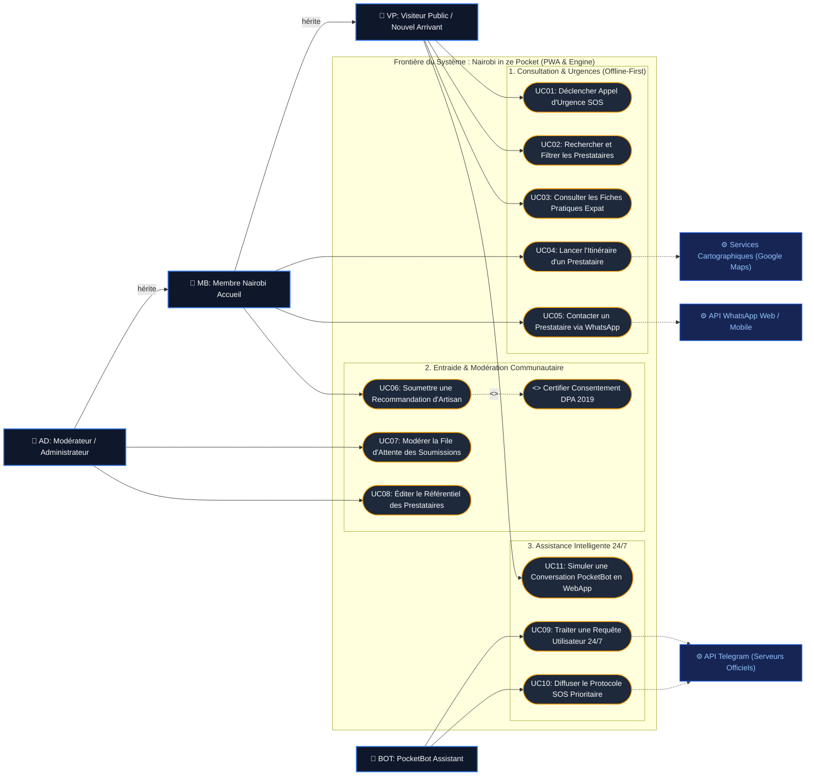

# Modélisation des Cas d'Utilisation UML — Nairobi in ze Pocket

> **Standard :** Conforme au skill `uml-usecase-designer` (ICPRA Edition) et au formalisme strict OMG UML 2.5.  
> **Traçabilité :** Chaque cas d'utilisation (`UCxx`) est relié aux exigences fonctionnelles du `AI-PRD.md`.

---

## 1. Diagramme des Cas d'Utilisation (Mermaid)

---

## 2. Matrice des Rôles & Traçabilité des Cas d'Utilisation

| Code UC | Libellé Métier du Cas d'Utilisation | Acteur Primaire | Condition Préalable | Exigence PRD |
| :--- | :--- | :--- | :--- | :--- |
| **UC01** | Déclencher un Appel d'Urgence SOS | Visiteur Public (`VP`) | Aucun (Disponible 100% Offline via PWA Service Worker) | REQ-SOS-01 |
| **UC02** | Rechercher et Filtrer les Prestataires | Visiteur Public (`VP`) | Aucune restriction | REQ-DIR-01 / 02 |
| **UC03** | Consulter les Fiches Pratiques Expat | Visiteur Public (`VP`) | Aucune restriction | REQ-GUI-01 |
| **UC04** | Lancer l'Itinéraire d'un Prestataire | Membre (`MB`) | Adresse valide du prestataire | REQ-DIR-03 |
| **UC05** | Contacter un Prestataire via WhatsApp | Membre (`MB`) | Numéro E.164 vérifié | REQ-DIR-03 |
| **UC06** | Soumettre une Recommandation d'Artisan | Membre (`MB`) | Consentement `consent_given=true` obligatoire | REQ-SUB-01 |
| **UC07** | Modérer la File d'Attente des Soumissions | Administrateur (`AD`) | Authentifié avec rôle admin Supabase | REQ-ADM-01 |
| **UC08** | Éditer le Référentiel des Prestataires | Administrateur (`AD`) | Authentifié avec rôle admin Supabase | REQ-ADM-02 |
| **UC09** | Traiter une Requête Utilisateur 24/7 | PocketBot (`BOT`) | Message reçu via Webhook HTTPS | REQ-BOT-01 |
| **UC10** | Diffuser le Protocole SOS Prioritaire | PocketBot (`BOT`) | Mots-clés vitaux détectés dans le prompt | REQ-BOT-02 |
| **UC11** | Simuler une Conversation PocketBot en WebApp | Visiteur Public (`VP`) | Navigateur compatible React | REQ-BOT-03 |
